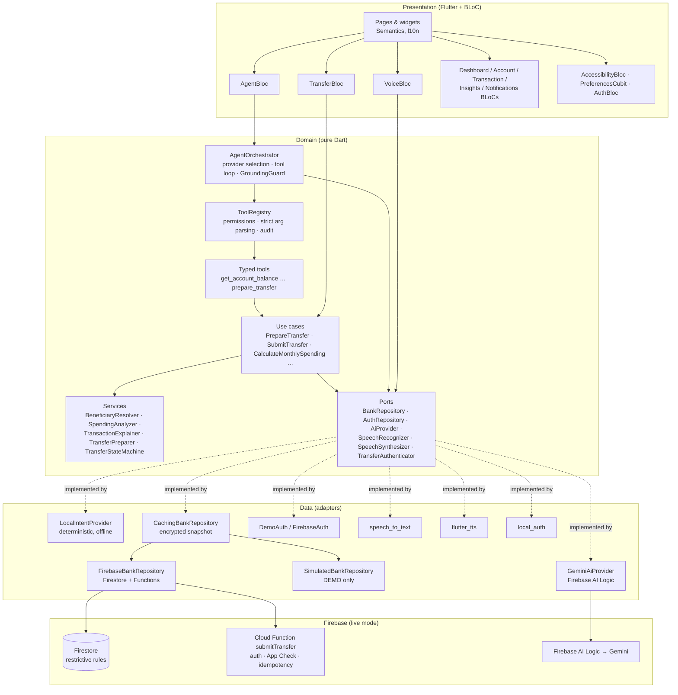

# Sauti — Architecture

## Overview

Sauti is a Flutter app organised by **feature**, each split into **presentation → domain ← data** (Clean Architecture). The domain layer is pure Dart; a test (`test/unit/architecture/domain_purity_test.dart`) fails the build if any `domain/` file imports Flutter, Firebase or a plugin, or if any `presentation/` file imports Firebase.

## Layers

| Layer | Contains | Depends on |
|---|---|---|
| `presentation/` | Pages, widgets, BLoCs/Cubits | domain, `core/` widgets & l10n |
| `domain/` | Entities, ports (abstract repositories/providers), use cases, services, tools, orchestrator | `core/` pure utilities (`Money`, `Result`, `Failure`, `Clock`) |
| `data/` | Repository and provider implementations, mappers, data sources | domain + infrastructure packages |
| `app/` | Composition root (`di/injection.dart`), router, theme, bootstrap | everything |

## Features

| Feature | Key types |
|---|---|
| `authentication` | `AuthRepository`, `DemoAuthRepository`, `FirebaseAuthRepository`, `AuthBloc`, welcome/login/register/reset pages |
| `banking` (shared banking core) | `Account`, `BankTransaction`, `Beneficiary`, `BankNotification`, `Fresh<T>`, `BankRepository`, simulated/Firebase/caching repositories, read use cases, `SpendingAnalyzer`, `TransactionExplainer`, `BeneficiaryResolver`, `TransferPreparer` |
| `dashboard`, `accounts`, `transactions`, `financial_insights`, `notifications` | Read-side BLoCs and pages |
| `transfers` | `TransferStateMachine`, `TransferAuthorization`, `PrepareTransfer`, `SubmitTransfer`, `TransferAuthenticator`, `TransferBloc`, prepare/confirm/receipt pages |
| `ai_agent` | `AiProvider`, `GeminiAiProvider`, `LocalIntentProvider`, `ToolRegistry`, banking tools, `AgentOrchestrator`, `GroundingGuard`, `AgentBloc`, assistant & history pages |
| `voice` | `SpeechRecognizer`, `SpeechSynthesizer`, platform adapters, `VoiceBloc` |
| `settings` | `AccessibilitySettings`, `AppPreferences`, `AccessibilityBloc`, `PreferencesCubit`, settings pages |

## Key design decisions

1. **The LLM never moves money.** Tools can only *read* or *prepare a draft*. Submission requires `SubmitTransfer` with a `TransferAuthorization` that only the UI can create after device authentication. The authorization is bound to the draft's idempotency key and expires after 2 minutes. `confirm_transfer` only re-shows the confirmation card for a draft the app created in this session.
2. **An explicit state machine** (`TransferStateMachine`) rejects illegal transitions, such as submitting before authenticating or cancelling while a submission is in flight.
3. **Money is stored as integers.** `Money` holds integer minor units (BIF has exponent 0). No `double` is used anywhere in monetary logic.
4. **Results, not exceptions.** Repositories and use cases return `Result<T>` with typed `Failure` codes, which map to localized messages in `core/l10n/l10n_ext.dart`.
5. **Every value carries its provenance.** Banking reads return `Fresh<T>` (live or cached, plus `asOf`). The UI and the agent always label cached data.
6. **The demo/live boundary lives in one place.** `configureDependencies` picks the simulated or Firebase implementations. DEMO mode shows a persistent banner on every screen, exposed to screen readers.
7. **No code generation.** `freezed`, `injectable` and `build_runner` were deliberately left out. Equatable plus explicit `get_it` registration keeps the build simple on a brand-new SDK (Flutter 3.50 with the `material_ui` split).
8. **Hybrid AI with honest tiers.** Gemini handles cloud inference; a deterministic local intent engine handles offline and fallback. No fake on-device LLM is shipped. See [AI_ARCHITECTURE.md](AI_ARCHITECTURE.md).
9. **Flutter 3.50 specifics.** Material comes from `package:material_ui`. The gen-l10n output still references the deprecated `flutter_localizations` delegates, so Sauti composes `material_ui` delegates itself, plus a fallback that serves French framework strings for Kirundi (`core/l10n/fallback_localizations.dart`).

## State management

Every meaningful screen uses a BLoC or Cubit with explicit events and states, injected use cases, and a deliberate concurrency transformer (`bloc_concurrency`):

| BLoC | Transformer rationale |
|---|---|
| `AgentBloc` | `droppable`: one banking request at a time |
| `TransferBloc` | `droppable` on draft, authentication and submit, which prevents duplicate submissions |
| `TransactionBloc` | `restartable`: typing cancels stale searches |
| `DashboardBloc`, `AccountBloc`, `InsightsBloc` | `restartable` refresh |
| `VoiceBloc` | `droppable` start-listening, `restartable` speak (a new reply interrupts the old one) |

`setState` is only used for ephemeral widget state, such as an onboarding page index or a password-visibility toggle.

## Navigation

`go_router` with a `StatefulShellRoute` for the four tabs (Home, Assistant, Activity, Settings). Redirect guards enforce this order: splash, then language, then onboarding, then auth, then home. A `ShellRoute` scopes a single `TransferBloc` instance across prepare, confirm and receipt.
